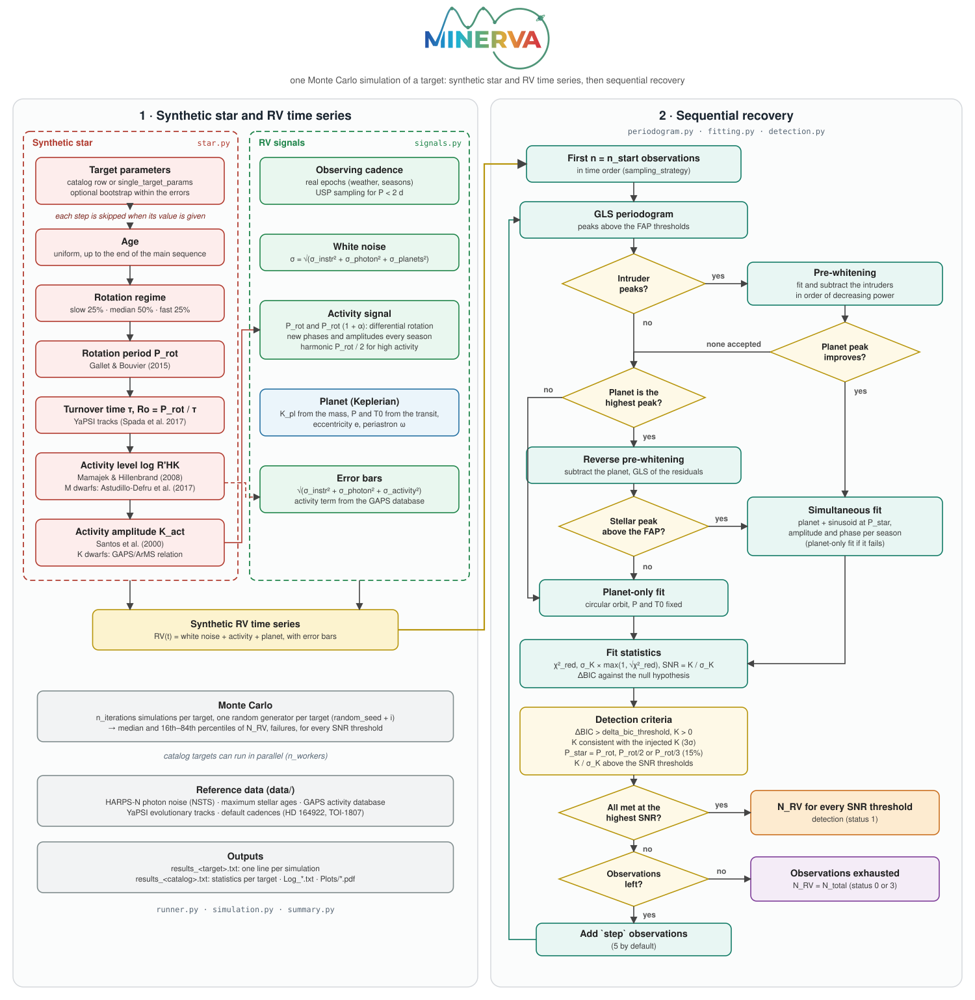

<p align="center"></p>

# MINERVA — MInimum observations for accurate Exoplanetary mass estimation with Radial Velocity Analysis

**How many radial-velocity observations are needed to measure the mass of a transiting planet, in the presence of stellar activity and with a realistic observing cadence.**


[](LICENSE)

<p align="center"></p>

## What is MINERVA

Precise planetary masses are needed to constrain the internal structure of exoplanets and
to break the degeneracies of atmospheric retrievals: missions such as Ariel require masses
with a precision of 30–40% for hundreds of targets. **MINERVA** estimates the number of
radial-velocity (RV) observations needed to reach a given precision on the mass of a
transiting planet orbiting an FGKM star, for single targets and for large samples
(Di Maio et al., A&A, submitted).

MINERVA is an *ab initio* forward-modelling simulator: it does not need previous RV
observations of the target. Each target is simulated many times (Monte Carlo); every
simulation builds a synthetic star, a synthetic RV time series on a real observing
cadence, and recovers the planet with an automated sequential analysis, adding
observations until the mass is measured with the required precision.

* **Stellar activity**: age, rotation, convective turnover time (YaPSI tracks), Rossby
  number, chromospheric activity log R'HK and RV amplitude from empirical calibrations,
  including a new GAPS/ArMS relation for active K dwarfs; or any of them fixed to known
  values.
* **Activity signal**: rotational modulation with differential rotation, seasonal
  evolution of phases and amplitudes, harmonics for very active stars.
* **Noise and error bars**: instrumental and photon noise (HARPS-N by default), unresolved
  additional planets, activity-driven extraction errors from the GAPS database.
* **Cadences**: real observing epochs, with weather and seasonal gaps; dedicated sampling
  for ultra-short-period planets.
* **Recovery**: GLS periodograms, pre-whitening of activity peaks, simultaneous planet +
  seasonal activity fits, BIC model comparison and detection criteria.
* **Performance**: vectorised GLS, parallel targets, reproducible runs (one random seed
  per target).

> **Versions.** The code used for the paper is tagged `v1.0-paper`. The current version is
> a restructured, documented package that also fixes several issues of that version
> (see [CHANGELOG.md](CHANGELOG.md)): its results differ from those of `v1.0-paper`.

## Contents

1. [Installation](#installation)
2. [Quick start](#quick-start)
3. [Running faster](#running-faster)
4. [Science cases](#science-cases)
5. [Documentation and API reference](#documentation-and-api-reference)
6. [Repository layout](#repository-layout)
7. [Data and third-party code](#data-and-third-party-code)
8. [Citing MINERVA](#citing-minerva)
9. [License](#license)
10. [Acknowledgements](#acknowledgements)

## Installation

**Requirements**

| Package | Version | Role |
|---|---|---|
| Python | ≥ 3.9 | |
| numpy, scipy, pandas | | core |
| astropy | | constants |
| matplotlib, seaborn | | figures |
| pyyaml, tqdm | | configuration, progress bars |

**Install** (from the repository root, editable mode):

```bash
git clone https://github.com/EXOPA-OAPa/MINERVA.git
cd MINERVA
python -m venv .venv && source .venv/bin/activate
pip install -e .
```

The reference data (photon noise, maximum ages, GAPS activity database, default cadences,
YaPSI tracks) are in `data/`. See [docs/installation.md](docs/installation.md) for details
and troubleshooting.

## Quick start

```bash
# a catalog of four fictitious targets (5 simulations per target: a quick check)
python scripts/run_minerva.py examples/01_catalog/config.yaml --quick

# a single target, 100 simulations, debug figures of the first simulations
python scripts/run_minerva.py examples/02_single_target/config.yaml

# your catalog, targets in parallel on all cores
python scripts/run_minerva.py my_config.yaml --workers auto
```

Every run writes, in the output folder: `results_<target>.txt` (one line per simulation),
`results_<catalog>.txt` (median and 16th–84th percentiles of the number of observations
per target, over all simulations and over the successful ones, and the number of
failures), the log and the figures ([output files](docs/api/conventions.md#output-files)).

## Running faster

* `run_options.n_workers`: catalog targets in parallel processes (`auto` = all cores),
  with results identical to a sequential run.
* `run_options.rv_series_pdf`: the RV time-series figure takes about half of the run time;
  use `False`, or N to draw it only for the first N simulations of each target.
* `analysis.gls_method`: `recurrence` (default) computes the GLS periodogram 2–4× faster
  than the original implementation (`reference`). Powers differ at the 10⁻⁹ level; in our
  tests (450 simulations) every result was identical. Use `reference` to reproduce the
  original computation exactly.
* Debug figures (`run_options`) slow the run down considerably: disable them for large runs.

## Science cases

Each case links to a page with the science background, what MINERVA models, the
configuration and the validation. **Examples** are complete configurations to copy and
edit; **tests** check the code against references.

| Science case | Mode | Example (customisable) | Validation test |
|---|---|---|---|
| [Planning a survey on a catalog](docs/cases/survey_planning.md) | catalog | [01](examples/01_catalog/config.yaml) | [regression](docs/api/testing.md#regression-test), [`check_parallel.py`](tests/check_parallel.py) |
| [Observing effort for a single target](docs/cases/single_target.md) | single target | [02](examples/02_single_target/config.yaml) | paper, Sect. 3.1 |
| [Stellar activity from age and rotation](docs/cases/stellar_activity.md) | any | [02](examples/02_single_target/config.yaml), [03](examples/03_known_activity/config.yaml) | [regression](docs/api/testing.md#regression-test) |
| [The injected activity signal](docs/cases/activity_signal.md) | any | [02](examples/02_single_target/config.yaml) | [regression](docs/api/testing.md#regression-test) |
| [Noise budget and error bars](docs/cases/noise_and_error_bars.md) | any | any | [regression](docs/api/testing.md#regression-test) |
| [Observing cadences](docs/cases/cadences.md) | any | [01](examples/01_catalog/config.yaml), [06](examples/06_usp_planet/config.yaml) | [regression](docs/api/testing.md#regression-test) |
| [Sequential recovery and detection criteria](docs/cases/signal_recovery.md) | any | any | [regression](docs/api/testing.md#regression-test), [`check_gls_methods.py`](tests/check_gls_methods.py) |
| [Uncertainties on the stellar parameters](docs/cases/parameter_uncertainties.md) | single target, catalog | [04](examples/04_bootstrap/config.yaml) | — |
| [Eccentric orbits](docs/cases/eccentric_orbits.md) | single target, catalog | [05](examples/05_eccentric_orbit/config.yaml), [01](examples/01_catalog/config.yaml) | [regression](docs/api/testing.md#regression-test) |

## Documentation and API reference

* **[API reference](docs/api/README.md)**: how the code works and every public function.
  * [Architecture and data flow](docs/api/README.md#architecture)
  * [Running MINERVA](docs/api/running.md): `run`, `RunContext`, `run_simulation`, statistics
  * [`minerva.star`](docs/api/star.md): age, rotation, convective turnover time, activity, K_act
  * [`minerva.signals`](docs/api/signals.md): noise, cadence, activity and planet signals, error bars
  * [Signal recovery](docs/api/recovery.md): periodogram, fitting, detection, fast GLS
  * [Utilities](docs/api/utils.md): input files, YaPSI tracks, debug figures, log
  * [Parameter reference](docs/api/parameters.md): every configuration key and catalog column
  * [Conventions](docs/api/conventions.md): units, random seeds, status codes, output files
  * [Command-line tools](docs/api/cli.md)
  * [Tests and validation](docs/api/testing.md)
* [Installation details](docs/installation.md)
* [Examples overview](examples/README.md)
* [Changelog](CHANGELOG.md)

## Repository layout

```
MINERVA/
├── src/minerva/         the package (installed with pip)
│   ├── runner.py        run(config): catalog and single-target runs, parallel targets
│   ├── context.py       configuration, folders, options, reference data
│   ├── simulation.py    one Monte Carlo simulation (the flowchart)
│   ├── star.py          stellar properties and activity
│   ├── signals.py       noise, cadence, activity and planet signals, error bars
│   ├── periodogram.py   GLS peaks, pre-whitening
│   ├── fitting.py       models and fits
│   ├── detection.py     fit statistics, detection criteria
│   ├── summary.py       statistics over the simulations
│   ├── fast_gls.py      vectorised GLS
│   ├── keplerian.py     Keplerian radial velocities (from RadVel)
│   ├── tracks.py, utils.py, plotting.py, logs.py
│   └── _vendor/gls.py   GLS periodogram (Zechmeister & Kürster 2009), unchanged
├── data/                reference data and YaPSI tracks
├── config/              config_example.yaml
├── examples/            one configuration per science case
├── scripts/             run_minerva.py, compress_yapsi_tracks.py, check_same_code.py, make_flowchart.py, make_logo.py
├── tests/               regression test and validation checks
├── docs/                this documentation
├── CHANGELOG.md
├── CITATION.cff         citation metadata
└── LICENSE              MIT
```

## Data and third-party code

| File | Content | Source / reference |
|---|---|---|
| `docs/images/minerva_logo.svg` | MINERVA logo; lettering in Montserrat converted to outlines | Montserrat, The Montserrat Project Authors, SIL Open Font License 1.1 |
| `src/minerva/keplerian.py` | Keplerian radial velocities and Kepler solver, from RadVel | Fulton et al. (2018), PASP 130, 044504 — [RadVel](https://github.com/California-Planet-Search/radvel), MIT license |
| `src/minerva/_vendor/gls.py` | Generalised Lomb-Scargle periodogram | Zechmeister & Kürster (2009), A&A 496, 577 — [github.com/mzechmeister/GLS](https://github.com/mzechmeister/GLS), MIT license |
| `data/YaPSI_Tracks/` | stellar evolutionary tracks (gzip-compressed, the 90 used) | Spada et al. (2017), ApJ 838, 161 — [YaPSI](http://www.astro.yale.edu/yapsi/) |
| `data/harps.rv` | default cadence for P ≥ 2 d: epochs of the HARPS-N monitoring of HD 164922 | Benatti et al. (2020), A&A 639, A50 |
| `data/time_usp.txt` | default cadence for P < 2 d: epochs of the HARPS-N observations of TOI-1807 | Nardiello et al. (2022), A&A 664, A163 |
| `data/NSTS_noise_new.txt` | HARPS-N photon noise vs V magnitude and spectral type | HARPS-N Exposure Time Calculator, [TNG](https://www.tng.iac.es/instruments/harps/tools/NSTS.jar) |
| `data/max_age_from_mass.dat` | maximum stellar age vs mass | from the YaPSI tracks (Spada et al. 2017) |
| `data/PLOT_POINTS_DATA_KG-KP-M-MP-YO-OC-KP-SO.csv` | RV extraction uncertainty vs log R'HK and spectral class: 250 FGKM stars, 15 270 GAPS observations | GAPS programme, Claudi et al. (in prep.); log R'HK of late-K and M dwarfs from Suárez Mascareño et al. (2015) and Astudillo-Defru et al. (2017) |

Relations implemented in the code: rotation period, Gallet & Bouvier (2015, A&A 577, A98);
log R'HK, Mamajek & Hillenbrand (2008, ApJ 687, 1264) and Astudillo-Defru et al. (2017,
A&A 600, A13); activity RV dispersion, Santos et al. (2000, A&A 361, 265); differential
rotation, Barnes et al. (2005, MNRAS 357, L1) and Reinhold et al. (2013, A&A 560, A4);
noise budget, Cloutier et al. (2018, AJ 156, 82). Please cite these works when using
MINERVA.

## Citing MINERVA

If you use MINERVA, please cite:

```bibtex
@ARTICLE{DiMaio_MINERVA,
  author  = {{Di Maio}, C. and {Benatti}, S. and {Colombo}, S. and {Piccinini}, G. and
             {Spinelli}, R. and {Fardella}, V. and {Claudi}, R. and {Micela}, G.},
  title   = "{Minimum observations for accurate Exoplanetary mass estimation with
             Radial Velocity Analysis (MINERVA)}",
  journal = {Astronomy \& Astrophysics},
  year    = 2026,
  note    = {submitted}
}
```

and the works of the data and relations above. See also `CITATION.cff` (GitHub shows a
"Cite this repository" button).

## License

MINERVA is distributed under the [MIT License](LICENSE). Third-party components keep
their own licenses (see above).

## Acknowledgements

<!-- Edit or remove: -->
The restructuring of the MINERVA code into a package (modularisation, performance
optimisation, tests) and its documentation were developed with the assistance of Claude
(Anthropic). All code and results were reviewed and validated by the authors.
