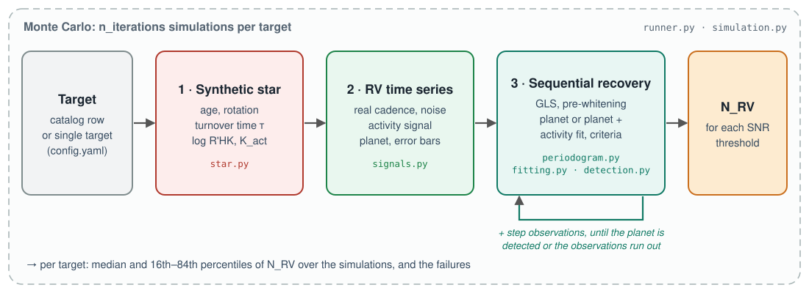
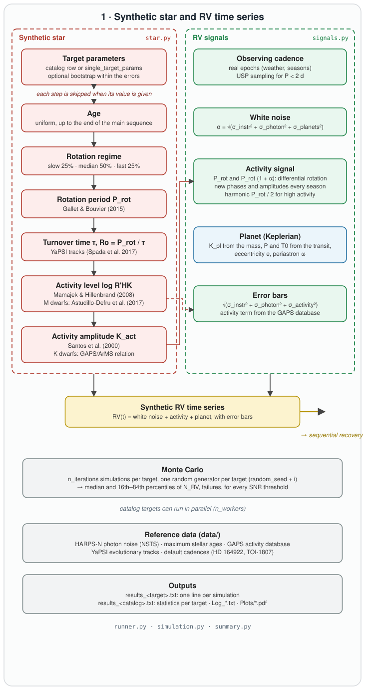
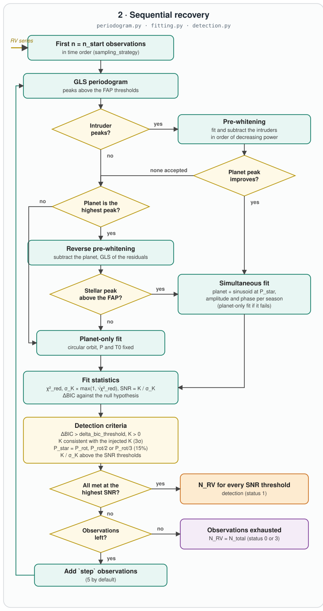

<p align="center"></p>

# MINERVA API reference

[← Back to README](../../README.md)

| Page | Content |
|---|---|
| [Architecture](#architecture) | how the pieces fit together, from the configuration to the results |
| [Running MINERVA](running.md) | `run`, `RunContext`, `run_simulation`, catalog and single-target runs, statistics |
| [`minerva.star`](star.md) | stellar properties: age, rotation, convective turnover time, activity, K_act |
| [`minerva.signals`](signals.md) | noise, cadence, activity signal, planet signal, error bars |
| [Signal recovery](recovery.md) | `periodogram`, `fitting`, `detection`, `fast_gls` |
| [Utilities](utils.md) | input files and configuration, YaPSI tracks, debug figures, log |
| [Parameters](parameters.md) | every configuration key and catalog column: unit, default |
| [Conventions](conventions.md) | units, time, random seeds, status codes, output files |
| [Command-line tools](cli.md) | `scripts/run_minerva.py`, utilities |
| [Tests and validation](testing.md) | what is tested and how to run it |

## Architecture

```
 config.yaml ──► context.RunContext ──► options, analysis parameters, folders
                      │                  reference data: NSTS photon noise, max ages,
                      │                  GAPS activity database, default cadences
                      ▼
 runner.run ──► run_catalog (targets, optionally in parallel processes) / run_single_target
                      │   for each target: random generator (random_seed + i),
                      │   n_iterations Monte Carlo simulations
                      ▼
 simulation.run_simulation  ─────────────────────────────────────────────────────────────
   1. synthetic star     star:    bootstrap ─► spectral type ─► age ─► rotation class
                                  ─► P_rot ─► τ, Ro (tracks) ─► log R'HK ─► K_act
   2. RV time series     signals: cadence, white noise, activity signal, planet,
                                  error bars (photon + instrumental + activity term)
   3. sequential recovery, n = n_start, n_start + step, ...
                         periodogram: GLS, significant peaks, planet vs intruders,
                                      pre-whitening / reverse pre-whitening
                         fitting:     planet-only or planet + seasonal activity fit,
                                      null hypothesis
                         detection:   χ², σ_K, SNR, ΔBIC, detection criteria
                         ─► stop at the detection, or when the observations are exhausted
   ─► number of observations needed and status for each SNR threshold
 ──────────────────────────────────────────────────────────────────────────────────────────
                      ▼
 summary.print_execution_summary ──► results_<target>.txt, results_<catalog>.txt, Log_*.txt
```

The same structure as a diagram:

<p align="center"></p>

### Detailed diagrams

An updated version of Fig. A.1 of the paper, in two parts (regenerate them with
`scripts/make_flowchart.py`, the overview with `scripts/make_overview.py`).

<table>
<tr>
<td align="center"><b>1 · Synthetic star and RV time series</b><br><sub><a href="star.md">star</a> · <a href="signals.md">signals</a></sub></td>
<td align="center"><b>2 · Sequential recovery</b><br><sub><a href="recovery.md">periodogram · fitting · detection</a></sub></td>
</tr>
<tr>
<td></td>
<td></td>
</tr>
</table>

### One Monte Carlo simulation

1. **Star.** With `bootstrap`, the stellar parameters are drawn from Gaussians centred
   on their catalog values. The spectral type is assigned from T_eff (F > 6000 K,
   G > 5000 K, K ≥ 3500 K, M below) unless given. Missing quantities are derived in
   chain: age (uniform, up to the end of the main sequence) → rotation regime (25% slow,
   50% median, 25% fast) → P_rot (Gallet & Bouvier 2015) → τ from the YaPSI track →
   Rossby number → log R'HK (Mamajek & Hillenbrand 2008; Astudillo-Defru et al. 2017
   for M dwarfs) → K_act (Santos et al. 2000; GAPS/ArMS exponential relation for K
   dwarfs). Stars without a convective envelope (τ ≈ 0) are inactive.
2. **Time series.** Epochs from the cadence (USP cadence for P < 2 d). The RV is
   white noise (σ_instr, σ_pl, σ_ph in quadrature) + activity signal (sinusoids at P_rot
   and P_rot(1+α), seasonal phases and amplitudes, harmonic for high activity) +
   Keplerian. Each epoch gets an error bar: σ_instr ⊕ σ_ph ⊕ σ_act,extr, the last term
   drawn from the GAPS database for active stars.
3. **Sequential recovery.** At each step the first `n_start + j·step` observations are
   analysed: GLS periodogram, classification of the significant peaks, pre-whitening of
   the intruders (or reverse pre-whitening of the planet), planet-only or simultaneous
   fit, fit statistics and detection criteria. Each SNR threshold records the number of
   observations at which it is first reached (reset if the detection is lost); the
   simulation ends when the highest threshold is reached.
4. **Result.** For each SNR threshold: the number of observations needed (the total
   number if never reached) and a status (1 detection, 3 false positive, 0 no detection).

### Random numbers

All random draws of a target use one generator, created with `random_seed + i` for the
i-th catalog target (`random_seed` for a single target). The draws happen in a fixed
order inside each simulation (bootstrap, white noise, age, rotation class, period,
activity signal, error bars), so a run is reproducible, and targets are independent of
each other (they can run in parallel with identical results). The sequential recovery
does not draw random numbers.

### Performance notes

* The GLS periodogram dominates the cost of the recovery. `analysis.gls_method:
  recurrence` (default) is a vectorised implementation, 2–4× faster than the original.
* The RV-series figure (`run_options.rv_series_pdf`) and the debug figures can cost
  more than the simulation itself: limit or disable them for large runs.
* YaPSI tracks are read once and kept in memory.
* Catalog targets run in parallel with `run_options.n_workers` (`auto`: all cores).
* Simulations that never reach a detection are the most expensive ones: they analyse
  every step up to the total number of observations.
