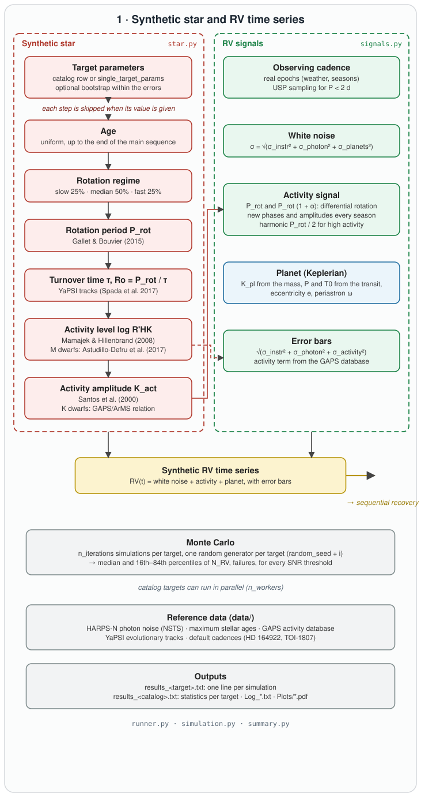

# `minerva.star` — synthetic star

[← API reference](README.md)

Each function implements one relation of the paper (Sect. 2.3). To change a relation,
change its function. Functions are called by `run_simulation` in this order (random
draws included), so the sequence of random numbers is fixed.

* [`bootstrap_parameters`](#bootstrap_parameters)
* [`check_spectral_type`](#check_spectral_type)
* [`stellar_age`](#stellar_age)
* [`rotation_class`](#rotation_class)
* [`rotation_period`](#rotation_period)
* [`rossby_number`](#rossby_number)
* [`activity_level`](#activity_level)
* [`activity_amplitude`](#activity_amplitude)

---

## bootstrap_parameters

`bootstrap_parameters(target_params, rng)` — only with `run_options.bootstrap: True`.

Draws each parameter with an uncertainty from a Gaussian centred on its value, in place:

| Parameter | Lower / upper bound |
|---|---|
| `star_mass` [M☉] | ≥ 0.08 |
| `star_temp` [K] | ≥ 2500 |
| `star_radius` [R☉] | ≥ 0.1 |
| `age` [Gyr] | ≥ 0.01 |
| `Prot` [d] | ≥ 0.5 |
| `log_Rhk` | ≤ −3.5 |

Every simulation starts from the nominal values (`run_simulation` works on a copy).

---

## check_spectral_type

`check_spectral_type(var, target_params) → bool`

Rejects T_eff > 7500 K and missing T_eff; assigns the spectral type from T_eff if not
given (F > 6000 K, G > 5000 K, K ≥ 3500 K, M below), otherwise checks that it starts with
F, G, K or M. Errors are written to the results file and the simulation is skipped.

---

## stellar_age

`stellar_age(var, target_params, rng) → age [yr]`

The catalog age, or a uniform draw between 10⁸ yr and

  age_max = min(10 Gyr (M < 1 M☉) or `max_age_from_mass.dat` (M ≥ 1 M☉), t_MS),

with t_MS the end of the main sequence of the YaPSI track used for τ
([`tracks.ms_lifetime`](utils.md#tracks)). A catalog age beyond t_MS is used with a
warning (τ then comes from the subgiant phase).

---

## rotation_class

`rotation_class(target_params, rng) → 'slow' | 'intermediate' | 'fast'`

The catalog value (`vsini_tag`), or a draw with probabilities 25% / 50% / 25%. Used only
to choose the rotation-period relation.

---

## rotation_period

`rotation_period(target_params, age, tag, rng) → (P_rot [d], log P_rot)`

The catalog value, or log P_rot = A + B log(age) with the coefficients of Gallet &
Bouvier (2015) for 1, 0.8 and 0.5 M☉ (G, K, M stars; paper, Table 1); before 1 Gyr
(3 Gyr for M stars) the coefficients depend on the rotation regime. F stars: log-uniform
P_rot in 9–12 d (≤ 6500 K), 5–9 d (6500–7000 K), 2–5 d (7000–7500 K).

---

## rossby_number

`rossby_number(var, target_params, age, P_rot) → (τ [d], Ro)`

Convective turnover time τ of the YaPSI track ([`tracks.track_pro`](utils.md#tracks)) at
the model closest in age, and Ro = P_rot / τ.

---

## activity_level

`activity_level(target_params, tau, R0, log_Prot, Prot) → (log R'HK, is_active)`

The catalog value, or:

* FGK (Mamajek & Hillenbrand 2008): log R'HK = −4.230 − 1.451 (Ro − 0.233) for Ro < 0.4,
  −4.522 − 0.337 (Ro − 0.814) otherwise;
* M (Astudillo-Defru et al. 2017): log R'HK = −1.509 log P_rot − 2.550 for P_rot > 10 d,
  −4.045 otherwise;
* τ < 0.001 d (no convective envelope): log R'HK = NaN, `is_active = False`.

---

## activity_amplitude

`activity_amplitude(target_params, log_Rhk, is_active) → K_act [m/s]`

The catalog value, 0 for inactive stars, or, with R5 = 10⁵ R'HK:

| T_eff [K] | K_act | Reference |
|---|---|---|
| 6000–7500 | 9.2 R5^0.75 | Santos et al. (2000) |
| 5000–6000 | 7.9 R5^0.55 | Santos et al. (2000) |
| 4000–5000 | 1.558 exp(0.605 R5), with log R'HK ≤ −3.99 | GAPS/ArMS calibration (MINERVA paper, Eq. 3) |
| 3500–4000 | 7.8 R5^0.13 | Santos et al. (2000) |
| < 3500 | 3.5 (log R'HK ≤ −5), 5.0 (log R'HK > −5) | |

The K-dwarf relation is calibrated for −5.03 ≤ log R'HK ≤ −3.99 and is not extrapolated:
larger values are capped at −3.99 (warning in the log).
